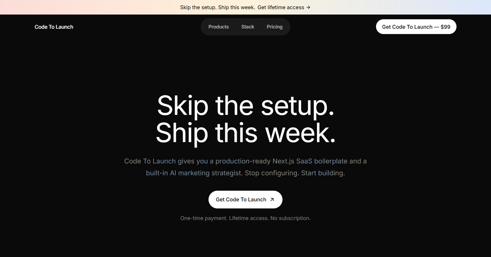

<p align="center">
  <a href="https://codetolaunch.pages.dev">
    
  </a>
</p>

<p align="center">
  <a href="https://codetolaunch.pages.dev">
    
  </a>
  <a href="https://iamzeiyn.notion.site/Market-Pilot-3b6128b86ed380149356c8da20fb2ae1">
    
  </a>
  
  
  
</p>

<p align="center">
  <a href="https://codetolaunch.pages.dev"><b>Website</b></a>
  &nbsp;·&nbsp;
  <a href="https://iamzeiyn.notion.site/Market-Pilot-3b6128b86ed380149356c8da20fb2ae1"><b>MarketPilot</b></a>
</p>

---

Production-ready Next.js 16 SaaS starter for founders who want to ship fast, not spend weeks on boilerplate.

## What's Included

### Boilerplate

A fully configured Next.js 16 codebase with auth, payments, database, email, file uploads, background jobs, and rate limiting, all wired up and ready to go. Clone, fill your `.env`, and start building your actual product.

### [MarketPilot](https://iamzeiyn.notion.site/Market-Pilot-3b6128b86ed380149356c8da20fb2ae1) *(Claude Skill)*

An AI marketing strategist built as a Claude skill. Drop it into your workflow and get instant help with positioning, pricing, Go-to-Market strategy, conversion, and retention, tailored to your specific business.

---

## Stack

| Layer | Library |
|---|---|
| Framework | `Next.js 16` `React 19` `TypeScript` |
| Styling | `Tailwind v4` `shadcn/ui` |
| Auth | `Better Auth` |
| Database | `Drizzle ORM` `Supabase` |
| Payments | `Polar.sh` |
| Email | `Resend` |
| Jobs | `Trigger.dev` |
| Cache / Rate limit | `Upstash Redis` |
| Uploads | `Uploadthing` |
| Analytics | `PostHog` |
| Monitoring | `Sentry` |

---

## Getting Started

```bash
pnpm install
pnpm dev
```

Set `NEXT_PUBLIC_CHECKOUT_URL` to your checkout URL before running the site.

## Checks

```bash
pnpm lint
pnpm build
```

---

<p align="center">One-time payment. Lifetime access. No subscription.</p>
